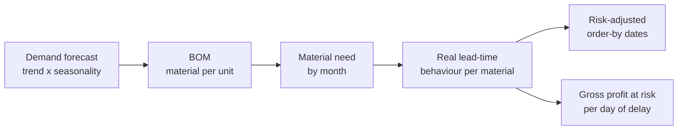

# El-Sharnouby Group: Business Intelligence & AI Challenge

**HVIA Task 02** | From data to decisions: connecting a fashion and textile group from raw materials to customers, and finding the hidden application nobody asked for.


> **Data note:** the dataset is modelled (synthetic) training data supplied for the challenge. The figures show *how* to analyse the business, not real company financials.

---

## Table of contents
1. [The challenge](#the-challenge)
2. [What this project delivers](#what-this-project-delivers)
3. [Key findings](#key-findings)
4. [The Final Mission: Demand-to-Supply Risk Radar](#the-final-mission-demand-to-supply-risk-radar)
5. [Repository structure](#repository-structure)
6. [Getting started](#getting-started)
7. [Methodology](#methodology)
8. [Assumptions and data limitations](#assumptions-and-data-limitations)
9. [Tech stack](#tech-stack)

---

## The challenge

El-Sharnouby Group is an integrated fashion and textile ecosystem: design, fabric, garment production, printing, retail (**LEO MODA**), online and wholesale. The task asks:

> *"Can you connect the full business before you analyze it?"*

The brief has three parts:

| Part | Scope |
|---|---|
| **7 applications** | Executive Command Center, Smart Inventory, Customer 360, Factory Digital Twin, Marketing Attribution, Branch Intelligence, Procurement and Supplier Risk |
| **10 Case Cards** | The detailed requirements, found in `Case_Briefs.csv` (the PDF images are illustrative mock-ups) |
| **Final Mission** | *"Build what we didn't ask for"*: find one high-value application hidden in the business. Think, build, prove, pitch |

## What this project delivers

| Deliverable | Description |
|---|---|
| **Analysis notebook** (`HVIA_Task02_Full_Project.ipynb`) | Data foundation, all 10 Case Cards, the Final Mission and a closing assumptions register. Every number in a "Key takeaways" cell is computed from the data |
| **Streamlit dashboard** (`app.py`) | Interactive app with filters, five tabs and a configurable Risk Radar |
| **Pitch deck** (`HVIA_Task02_Pitch.pptx`) | 7-slide presentation |
| **Ready-to-use outputs** (`deliverables/`) | Replenishment plan, win-back list, supplier action matrix, order calendar, action plan and more (CSV) |

## Key findings

| Area | Finding |
|---|---|
| **Growth** | FY26 net sales **148.3M EGP**, growth slowed from **+10.8% to +3.3%**; margin flat at about 15% |
| **Channel mix** | Wholesale is **85% of sales but 66% of gross profit** (11.9% margin vs 35-37% for Retail and Online) |
| **Channel growth** | Online **+26%**, the single retail store **-7%** |
| **Marketing** | **261 of 420 campaigns lose money** once product margin is applied; ROAS figures are upper bounds |
| **Factory** | 16% of orders finish late and **every late order has a named bottleneck**; Sewing and Finishing are **68%** of delay days. Production lines themselves perform almost identically |
| **Quality** | The top refund reason is **Size / fit (37% of refunds)**, a sizing problem that factory QC cannot catch |
| **Supply** | Only **56%** of purchase orders arrive on time and in full; two suppliers (**SUP09, SUP04**) cause 29% of late deliveries; the lead-time master data is wrong for all 12 materials |
| **Action plan** | Six non-overlapping actions add about **7.2M EGP** of gross profit a year (31% of FY26) |

## The Final Mission: Demand-to-Supply Risk Radar

**The hidden application:** purchasing plans with master-data lead times, but real deliveries are later and vary by supplier. Nobody joins the forecast, the bill of materials and the supplier behaviour. The Radar does:



**Result:** 3 RED-tier materials (sewing thread, poly bags, neck labels, used in every product) and **20 of 30** order lines for the next three months are already inside their lead time.

**Proof on unseen data:** the Radar learns from purchase orders placed before October 2025 and is tested on later ones. The risk-adjusted lead time holds for **93%** of new orders, against **51%** with the master-data lead time. The same two suppliers are the worst in both periods.

> Honest limit: moving volume away from the two weak suppliers improves on-time delivery (54% vs 31%) but does **not** shorten the 90th-percentile lead time, so earlier ordering is needed whichever supplier is used.

## Repository structure

```
.
├── README.md
├── requirements.txt
├── HVIA_Task02_Full_Project.ipynb   # full analysis (Phase 0 + 10 cards + Final Mission)
├── app.py                           # Streamlit dashboard
├── HVIA_Task02_Pitch.pptx           # pitch deck
├── deliverables/                    # CSV outputs generated by the notebook
│   ├── replenishment_plan.csv
│   ├── winback_list_top500.csv
│   ├── wholesale_accounts_silent_60d.csv
│   ├── supplier_material_action_matrix.csv
│   ├── quality_priority_products.csv
│   ├── radar_material_risk.csv
│   ├── po_calendar_next_90d.csv
│   └── management_action_plan.csv
└── sharnouby_data/                  # the 20 source CSV files (not included, see below)
```

## Getting started

### 1. Install
```bash
git clone <your-repo-url>
cd <your-repo-folder>
python -m pip install -r requirements.txt
```
The notebook was tested on Python 3.9 and 3.12 (pandas 2.2 and 3.0); the dashboard was tested on Python 3.12.

### 2. Add the data
Place the 20 CSV files inside a folder named `sharnouby_data` next to the notebook and `app.py`.

### 3. Run the notebook
Open `HVIA_Task02_Full_Project.ipynb` in Jupyter or VS Code and run all cells (about 2 minutes). It writes `clean/` (cleaned tables) and `deliverables/` (CSV outputs).

### 4. Run the dashboard
```bash
python -m streamlit run app.py
```
It opens at `http://localhost:8501`. Use the sidebar to change the data folder, fiscal year and channel.

**Dashboard tabs:** Overview, Customers (RFM and win-back list), Marketing, Operations, Supply Risk Radar (editable stock-on-hand table, sliders, CSV download).

## Methodology

- **Phase 0, data foundation:** inventory of all tables, cleaning, 13 foreign-key checks with zero orphans, 15 reconciliation tests, one shared date table.
- **Card analyses:** KPIs, trends, seasonality, ABC/XYZ, RFM and cohorts, discount and margin analysis, defect Pareto, OTIF, cost trends.
- **Forecasting:** four candidate models (naive, moving average, seasonal naive with growth, trend x seasonality) back-tested on rolling origins; the best is selected on error, with the total-level error band shown.
- **Quantification:** every weakness is expressed in EGP, and scenario tables show sensitivity to the key assumption (for example discount cap versus volume retention).
- **Proof:** out-of-sample test of the Radar's lead-time estimate.

## Assumptions and data limitations

All assumptions are named parameters in the code and listed in the notebook's closing section.

- **Fiscal year** is October to September (FY24 to FY26).
- **Gross profit** is net sales minus estimated COGS; no other costs exist in the data.
- **Channel vs customer type:** FY24 contains 15.5M EGP of Wholesale-channel sales to Retail-type customers.
- **Scale mismatches:** production orders cover about 3.8x the units sold, and purchase-order spend is about 2.5x total COGS. Production-based EGP values are scaled by an explicit factor, and purchase orders are used only for supplier *behaviour*, never for volumes.
- **Marketing attribution** exceeds total direct sales, so ROAS is an upper bound that needs a holdout test.
- **No raw-material stock or open purchase orders** exist in the data; the Radar computes what to order and when, and accepts real stock through the dashboard.
- **Statistical links** between stages month to month are weak in this modelled dataset, so the integrated story relies on structural links (BOM, lead times, product keys).

## Tech stack

Python, pandas, NumPy, matplotlib, Plotly, Streamlit, Jupyter, PptxGenJS for the deck.

---

*Built for the HVIA Data & AI Solutions Business Intelligence & AI Applications Challenge.*
